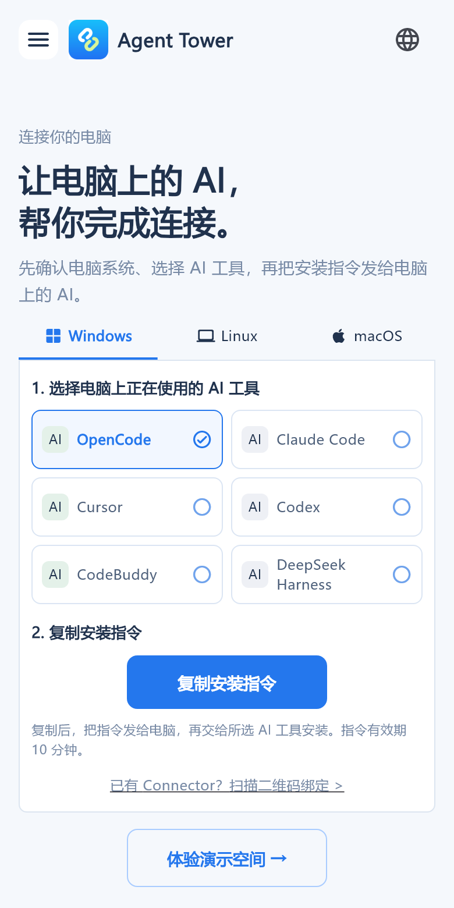
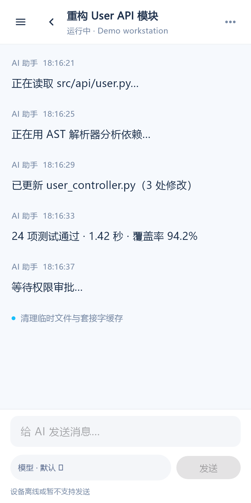
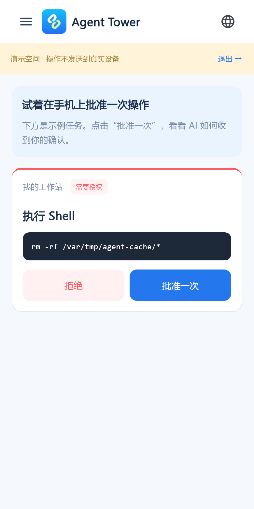

# Agent Tower Client

**Your pocket command center for AI coding agents: follow tasks, read conversations and review operations away from your desk.**

[简体中文](README.md) · [Connector](https://github.com/agenttower-ai/agent-connector) · [Server](https://github.com/agenttower-ai/agent-tower-server) · [iOS App Store](https://apps.apple.com/app/id6820363505)

Agent Tower Client is rendered natively with Flutter, without a WebView. It connects through AgentTower Server to Connector on your computers, bringing agent activity and supported remote operations to your phone.

## Related projects

| Project | Role |
| --- | --- |
| [Agent Connector](https://github.com/agenttower-ai/agent-connector) | Runs on the computer with your AI agents; syncs status and supported operations |
| [Agent Tower Server](https://github.com/agenttower-ai/agent-tower-server) | Pairs devices, manages access and relays messages |
| [Agent Tower Client](https://github.com/agenttower-ai/agent-tower-client) | Flutter client for progress, conversations and supported approvals |

Use all three with the same relay for a complete self-hosted setup. Agent capabilities vary by adapter.

## Use cases

| Situation | What you can do |
| --- | --- |
| A long task is running and you want to leave your desk | Follow devices, agent status and session progress |
| An agent is waiting for permission | Read supported approval requests and approve or reject them |
| You want to add instructions | Read history and continue conversations when the adapter supports it |
| Agents run across several computers | Follow paired devices and their projects in one client |

Capabilities depend on the Connector adapter. Not every tool supports remote conversation or approvals. Tasks still execute on the original computer, which must stay on with the agent and Connector running.

## Three screenshots

| Connect your computer | Example conversation | Review an operation |
| --- | --- | --- |
|  |  |  |

These actual Flutter screens use demo data. Demo operations are not sent to real devices. The source build defaults to an example relay rather than the official production service.

## How it works

```text
AI agent on your computer ↔ Connector ↔ Server ↔ Agent Tower Client (this repository)
```

1. Run [Server](https://github.com/agenttower-ai/agent-tower-server) and provide HTTPS/WSS for remote access.
2. Run [Connector](https://github.com/agenttower-ai/agent-connector) on the computer running your agent, connect it to that same service and install the adapter you need.
3. Set the relay when building the client or switch it in the client settings. Scan a one-time QR code or enter the binding code and confirm pairing.
4. Follow status and conversations and handle supported operations.

## Develop locally

The recorded development toolchain is Flutter 3.47.4; see `.flutter-version`. Dart constraints are in `pubspec.yaml`. Android uses JDK 17, SDK 36 and NDK 27.1.12297006. Building for iOS/macOS requires macOS and Xcode.

```sh
flutter pub get
flutter analyze
flutter test
flutter run --dart-define=AGENTTOWER_SERVER_URL=https://relay.example.com
```

Replace the example URL with your HTTPS service. Help links, including those in `lib/external_link.dart`, also point to the example domain; replace them with your documentation before distributing your own build.

```sh
flutter build apk --debug --dart-define=AGENTTOWER_SERVER_URL=https://relay.example.com
flutter build ios --no-codesign --dart-define=AGENTTOWER_SERVER_URL=https://relay.example.com
```

The second command runs on macOS only. The public project has no Apple development team configured and includes no Android release key. Store distribution requires your own identifiers, signing and store configuration. Android falls back to debug signing without release keys; that is not a store release build.

## Platforms and layout

Android and iOS are the primary mobile targets. macOS and Windows projects are included, but desktop functionality requires separate platform verification. Linux and Web projects are not included.

| Directory | Contents |
| --- | --- |
| `lib/` | Flutter pages, conversations, approvals, connection state and localization |
| `android/`, `ios/` | Native bridges, credential storage, scanning and platform projects |
| `macos/`, `windows/` | Desktop projects and native bridges |
| `assets/` | Product artwork, agent icons and third-party notices |
| `test/`, `integration_test/` | Unit, widget and native integration tests |

Verify native credential storage, camera permissions and scanning on real devices. The native credential integration test temporarily reads and writes the current installation's credential store; use an isolated test environment.

## Data and license

The client uses independent installation credentials and device authorization relationships. Never publish credentials, real sessions, signing files or runtime data. There is no end-to-end encryption: the relay can read forwarded content. Choose a trusted relay.

The [license](LICENSE) is **MIT with additional attribution-preserving terms**, not standard MIT. Commercial use, modification and redistribution are allowed without requiring disclosure of business source or modifications. Preserve copyright notices, the full license and existing AgentTower attribution in service identifiers. Dependencies and icons retain their own licenses; see [THIRD_PARTY.md](THIRD_PARTY.md).

For sanitized reports and contributions, see [CONTRIBUTING.md](CONTRIBUTING.md) and [SECURITY.md](SECURITY.md).
