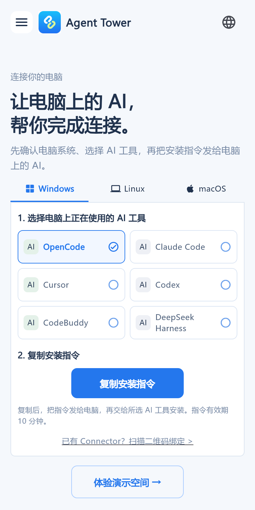
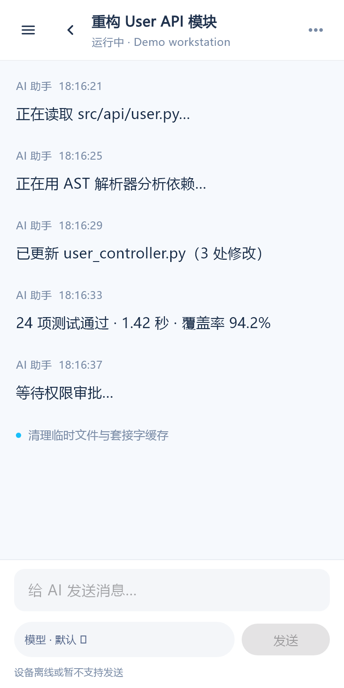
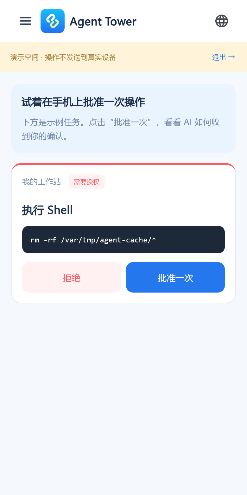

# Agent Tower Client

**你的 AI Agent 随身指挥台：离开电脑，也能跟进任务、查看会话和确认操作。**

[English](README.en.md) · [Connector](https://github.com/agenttower-ai/agent-connector) · [Server](https://github.com/agenttower-ai/agent-tower-server) · [iOS App Store](https://apps.apple.com/app/id6820363505)

Agent Tower Client 是使用 Flutter 原生渲染的控制客户端，不使用 WebView。通过 AgentTower Server 连接运行在电脑上的 Connector，把 AI 编程 Agent 的进展和受支持的远程操作带到手机。

## 关联项目

| 项目 | 负责什么 |
| --- | --- |
| [Agent Connector](https://github.com/agenttower-ai/agent-connector) | 运行在 Agent 所在的电脑，同步状态与受支持的操作 |
| [Agent Tower Server](https://github.com/agenttower-ai/agent-tower-server) | 设备绑定、访问授权和消息中转 |
| [Agent Tower Client](https://github.com/agenttower-ai/agent-tower-client) | Flutter 客户端，查看进展、会话并处理受支持的审批 |

完整自托管需要三者连接同一个中转服务；各 Agent 的可用能力取决于适配器。

## 使用场景

| 场景 | 你可以做什么 |
| --- | --- |
| 长任务还在跑，想暂时离开工位 | 查看设备、Agent 状态和会话进展 |
| Agent 正等待授权 | 阅读支持远程审批的操作请求，批准或拒绝 |
| 想继续补充任务要求 | 在适配器支持时查看历史、继续对话 |
| 多台电脑分别运行 Agent | 在一个客户端查看已绑定设备及其项目 |

支持能力取决于 Connector 适配器；不是所有工具都能远程对话或审批。任务仍在原电脑执行，需要电脑、Agent 和 Connector 保持运行。

## 三张截图

| 连接电脑 | 会话示例 | 操作审批 |
| --- | --- | --- |
|  |  |  |

截图来自实际 Flutter 界面，使用演示数据；演示操作不会发送到真实设备。仓库中的源码构建版默认使用示例服务器，不连接官方生产服务。

## 工作方式

```text
电脑上的 AI Agent ↔ Connector ↔ Server ↔ Agent Tower Client（本仓库）
```

1. 运行自己的 [Server](https://github.com/agenttower-ai/agent-tower-server)，为远程访问配置 HTTPS/WSS。
2. 在运行 Agent 的电脑上启动 [Connector](https://github.com/agenttower-ai/agent-connector)，连接同一个服务并安装所需适配器。
3. 编译客户端时指定该服务，或在客户端的服务器设置中切换地址；扫描一次性二维码或输入绑定码，并确认关系。
4. 查看会话和状态，处理适配器支持的操作。

## 本地开发

开发工具链记录为 Flutter 3.47.4，版本文件见 `.flutter-version`；Dart 约束见 `pubspec.yaml`。Android 工程使用 JDK 17、SDK 36、NDK 27.1.12297006。iOS/macOS 的构建需要 macOS 和 Xcode。

```sh
flutter pub get
flutter analyze
flutter test
flutter run --dart-define=AGENTTOWER_SERVER_URL=https://relay.example.com
```

将示例域名替换为自己的 HTTPS 服务。`lib/external_link.dart` 等帮助链接也使用示例域名，发行自己的版本前请替换为自己的文档页面。

```sh
flutter build apk --debug --dart-define=AGENTTOWER_SERVER_URL=https://relay.example.com
flutter build ios --no-codesign --dart-define=AGENTTOWER_SERVER_URL=https://relay.example.com
```

第二条命令只在 macOS 上运行。公开工程未配置 Apple 开发团队，也不包含 Android 发布密钥；发行到商店需要你自己的应用标识、签名与商店配置。未配置发布密钥时 Android 工程会使用调试签名，不能当作商店发布包。

## 平台与目录

主要移动端目标为 Android 和 iOS；同时保留 macOS、Windows 工程，桌面功能须在对应平台另行验证。没有附带 Linux 或 Web 工程。

| 目录 | 内容 |
| --- | --- |
| `lib/` | Flutter 页面、会话、审批、连接状态与多语言文案 |
| `android/`、`ios/` | 原生桥接、凭证存储、扫码及平台工程 |
| `macos/`、`windows/` | 桌面平台工程与原生桥接 |
| `assets/` | 客户端图片、Agent 图标及第三方声明 |
| `test/`、`integration_test/` | 单元、界面与原生集成测试 |

原生凭证读写、相机权限及扫码需要在真实设备上另行验证。原生凭证集成测试会临时读写当前安装的凭证存储，请使用独立测试环境。

## 数据与许可

客户端使用独立安装凭证及设备授权关系。不要公开凭证、真实会话、签名材料或运行数据。传输不是端到端加密，中转可读取转发内容，请使用可信服务。

采用 [MIT + 标识保留补充条款](LICENSE) 自定义许可，**不是标准 MIT**。允许商用、修改及分发，不要求公开业务源码或修改代码；须保留版权、完整许可，以及服务标识中已有的 AgentTower 来源信息。第三方依赖与图标遵循各自许可，参见 [THIRD_PARTY.md](THIRD_PARTY.md)。

欢迎提交脱敏的问题与改进，见 [CONTRIBUTING.md](CONTRIBUTING.md) 和 [SECURITY.md](SECURITY.md)。
